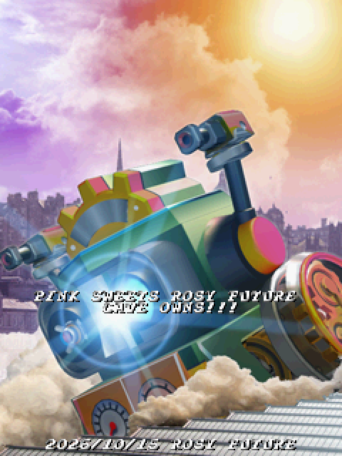
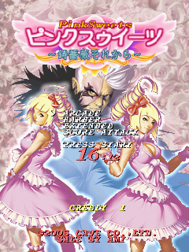
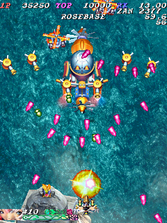

# Pink Sweets Rosy Future

A patch for **Pink Sweets: Ibara Sorekara** (Cave, CV1000 / SH-3, 2006/04/06 MASTER VER....), applied to the program ROM `u4`.

| | CRC32 |
|---|---|
| Original `u4` (required) | `5d812c9e` |
| Patched `u4` | `b0dcd310` |

Only `u4` changes. `u2`, `u23` and `u24` stay as they are. No ROM data is included in this repository.

## What it adds

- **ZAN counter.** Shows the hidden 1UP counter. It starts at 2500, kills lower it and bomb kills raise it again. At 0 it shows **READY**, and it goes back to 2500 after the extra life item appears.
- **Boss and midboss timer.** Shows the seconds left in every boss and midboss fight from stage 1 to stage 7, with one decimal. It only appears during those fights.
- **Boss health.** Shown under the timer and counts down as the enemy takes damage.
- **Rank meter.** Shows the hidden rank as a percentage in place of the 2P score. 100% is the hardest and the game starts at 18.75%.
- **Title menu.** After a coin is inserted, the title shows **ARCADE / HARDER / EXTENDED / SCORE ATTACK**.
  - Move the arrow with the joystick and press Start.
  - Harder, Extended and Score Attack are unlocked, so the button codes aren't needed.
- **HUD layout.**
  - Arcade, Harder and Extended: ZAN sits under RANK on the right, with the boss timer and health under it in place of the credit message.
  - Score Attack: no extra HUD, the game's own display is left as it is.
  - 2 players: ZAN, the boss timer and the rank meter are removed and the 2P score comes back.
- **Warning screen.** Shows `PINK SWEETS ROSY FUTURE` and `CAVE OWNS!!!`, with `2026/10/14 ROSY FUTURE` at the bottom.

## Screenshots

<table>
  <tr>
    <td align="center"></td>
    <td align="center"></td>
    <td align="center"></td>
  </tr>
  <tr>
    <td align="center">Warning screen</td>
    <td align="center">Title menu with all four modes</td>
    <td align="center">Arcade with rank, ZAN and the boss timer and health</td>
  </tr>
</table>

## Web patcher

The easiest way: open the **[Pink Sweets Rosy Future Patcher](https://galaxybrian.github.io/Pink_Sweets_Rosy_Future/)** and drop in `pinkswts.zip`. You can also drop a loose `pinkswts_u4`.

The page checks that `pinkswts_u4` is the original (`5d812c9e`) and patches it. It then checks the result is `b0dcd310` before offering:

- `pinkswts.zip`: the full set with `pinkswts_u4` replaced
- `pinkswts_u4.zip`
- the raw `pinkswts_u4`

Everything runs in your browser and nothing is uploaded.

## Before you flash

MAME will warn about a wrong checksum for `u4`. That's expected.

On real hardware, **read and keep a backup of your original u4 flash** before writing the patched one.

## Testing
This patch was tested with MAME 0.289 and [CV1k core for the MiSTer FPGA by Raki](https://www.patreon.com/c/ikamusume/posts) 

## Credits

- [GalaxyBrian](https://github.com/GalaxyBrian)  project, testing
- [Claude](https://claude.ai) (Anthropic)  reverse engineering and patch code
- Rank research from the [shmups.wiki](https://shmups.wiki) Pink Sweets pages

## Disclaimer

This project is not affiliated with or endorsed by Cave. Pink Sweets is a trademark of their respective owners. 
You must supply your own legally obtained ROM dump.
